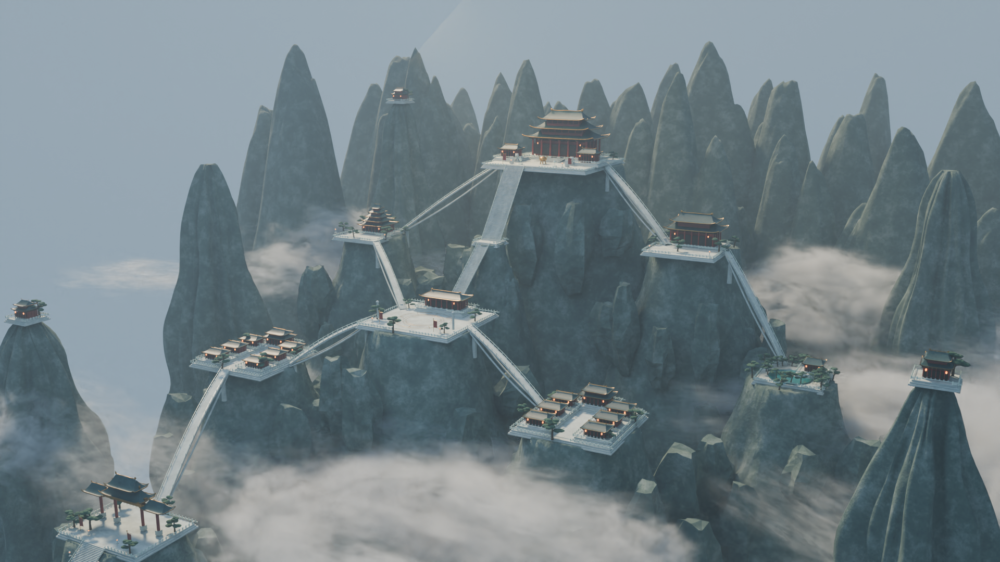

# 云海仙宗 · Yunhai Sect

A cultivation sect named "Yunhai Sect".

中国仙侠宗门三维场景与可交互网页漫游：群山、宫殿、石阶、悬桥、松林和云海。

## 在线体验

[进入云海仙宗 · 山海漫游](https://yunhai-sect.vercel.app/)

已部署至 Vercel，支持环绕观景与步行探索。



## 工程目录

- `blender/云海仙宗.blend`：完整可编辑场景，使用 Blender 5.2.3 LTS 创建，约 31 MB。
- `web/`：Three.js 网页源码、压缩模型、材质、漫游控制和碰撞测试。
- `previews/`：全景、主殿、山门检查图与网页预览。
- `docs/`：建模说明、场景清单和检查记录。

## 启动网页

需要 Node.js 20.19+ 或 22.12+。

```sh
cd web
npm ci
npm run dev
```

浏览器打开 http://127.0.0.1:4318/ 。

```sh
npm test
npm run build
```

构建产物在 `web/dist/`，可部署到静态网站服务。请通过 HTTP 服务访问，不要直接双击 HTML。

## 漫游操作

- 环绕模式：拖动旋转、滚轮缩放、右键平移。
- 步行模式：点击画面后，WASD / 方向键移动，Shift 加速，Esc 释放鼠标。
- 鼠标锁定不可用时，按住画面拖动转头。
- 手机：左侧摇杆移动、右侧拖动转头。
- 六个观景点可传送，支持画质与云雾开关。

碰撞控制包含地面跟随、台阶高度限制、墙体/栏杆阻挡和悬崖防跌落。室内尚未建模，殿身不可穿入。

## 模型与渲染

网页模型 `web/public/assets/sanctuary.glb` 约 2.95 MB，采用 Draco 压缩、合并网格与减面。离线材质转换为实时 PBR，体积云替换为轻量雾效；网页视觉与 Cycles 离线渲染不同。

原始 Blender 工程无需网页依赖即可打开和编辑。渲染参数与操作方法见 [使用说明](docs/使用说明.md)。

## 部署到 Vercel

1. 在 Vercel 新建项目，导入 `teddy-bear-bot/Yunhai_Sect`。
2. **Root Directory 选择 `web`**（不是仓库根目录）。
3. Framework Preset 选择 Vite；Build Command 为 `npm run build`，Output Directory 为 `dist`，Install Command 为 `npm ci`。
4. 使用 Node.js 22.x，不需要环境变量，点击 Deploy。

`web/vercel.json` 已提供构建配置。网页使用的 GLB 和 Draco 解码器均位于 `web/public/`，会随构建一起发布；Blender 工程和预览文档不在网页输出目录中。

若需要限制访问，可在 Vercel 项目中配置访问保护。

参考：https://vercel.com/docs/builds/configure-a-build
